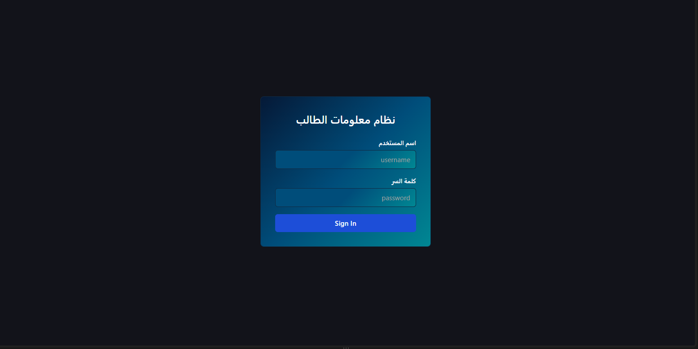

This was a project for a college event
i did not have enough time to finish it
uses Microsoft SQL (managed by SSMS) pure HTML CSS and Javascript
with nodejs as the backend
API calls to the database are Parameterized to stop SQL injection

Login page makes api call to database to check USERS table for valid password and username
(Passwords arent hashed for the purpose of simplicity in modifying user database)

